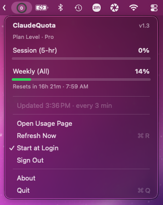
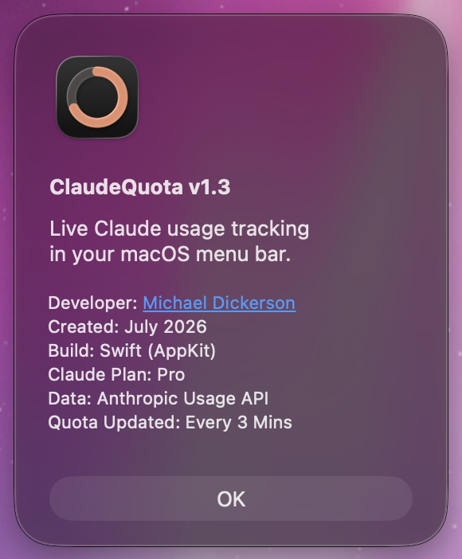
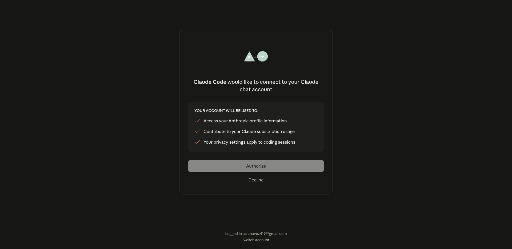
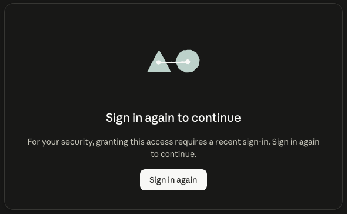
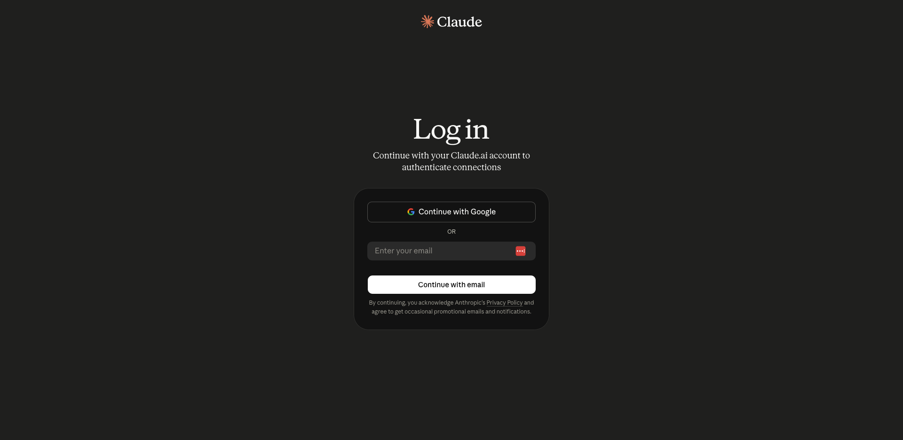
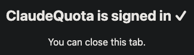
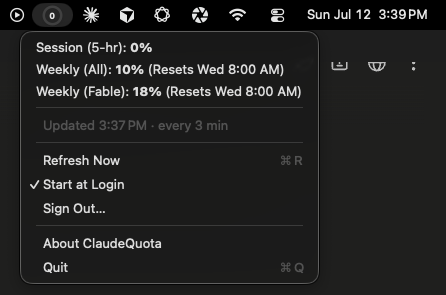
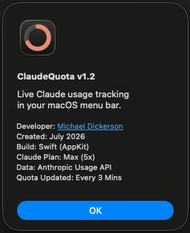
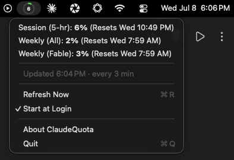
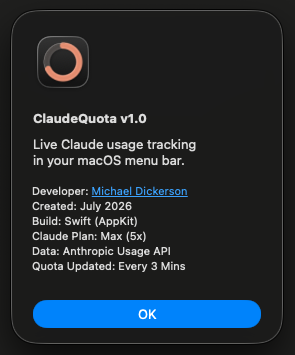

# ClaudeQuota

**Live Claude usage tracking in your macOS menu bar.**

ClaudeQuota is a tiny native macOS menu bar app that shows your Claude plan usage limits at a glance — the same numbers as claude.ai → Settings → Usage — without keeping a browser tab open. A color-coded ring gauge sits in your menu bar with your current 5-hour session percentage inside it; click it for the full breakdown.

<p align="center">
  
  &nbsp;&nbsp;
  
</p>

## Features

- **Ring gauge in the menu bar** — session usage % inside a progress ring; green → orange (≥75%) → red (≥90%)
- **Full breakdown on click** — 5-hour session, weekly (all models), and model-specific weekly limits, each with a color-coded progress bar and its reset time ("Resets in 4h 28m · 4:10 PM")
- **Live plan detection** — the menu shows your current plan level (Pro, Max 5x, …), and so does the About panel
- **One click to the full picture** — **Open Usage Page** jumps to your usage settings on claude.ai
- **Extra Usage support** — if you enable Anthropic's paid overage credits, a monthly credits row appears automatically
- **Notifications** — one-time alerts when session usage crosses 80% and 95%
- **Auto-refresh every 3 minutes** — with automatic backoff if Anthropic rate-limits, and a "last updated" line so staleness is always visible
- **Works with any Claude account** — sign in from the menu bar with your Claude credentials (browser OAuth), or let it connect automatically if the Claude Code coding tool is installed
- **Start at Login**, no Dock icon, zero dependencies — one Swift file

## Requirements

- macOS 13 (Ventura) or later
- A Claude subscription (Pro or Max) — that's it. It doesn't matter how you use Claude (website, desktop app, or Claude Code); ClaudeQuota can always sign in on its own
- Xcode Command Line Tools (`xcode-select --install`) to build

> **"Claude Code" vs. the Claude desktop app — an important distinction.** Throughout this README, *Claude Code* means Anthropic's coding tool (the `claude` terminal/IDE agent) — **not** the Claude desktop chat app and not claude.ai in a browser. Only Claude Code stores credentials in the macOS Keychain where ClaudeQuota can borrow them for a silent, zero-setup connection. The desktop app and website keep their credentials to themselves — if that's how you use Claude, just click **Sign In** in the menu instead. Same result either way.

## Install

```sh
git clone https://github.com/Dickie2306/ClaudeQuota.git
cd ClaudeQuota
./build.sh
open /Applications/ClaudeQuota.app
```

**First launch, with the Claude Code coding tool installed and logged in:** macOS asks for permission to read the "Claude Code-credentials" Keychain item — click **Always Allow** and ClaudeQuota connects on its own. No sign-in needed.

**First launch for everyone else** (you use Claude via the website or the desktop chat app): the menu bar shows **◔ Sign In** — click it, choose **Sign In**, and approve in the browser (the consent page says "Claude Code" because ClaudeQuota authenticates with the same public OAuth client Anthropic's CLI uses). The tab confirms "ClaudeQuota is signed in ✓" and the gauge appears within seconds.

The entire sign-in happens between **your browser and Anthropic** — ClaudeQuota never sees your password, and never asks for it. Here's the full flow, so you know exactly what to expect:

<p align="center">
  
</p>
<p align="center"><em>1. Anthropic's consent page — the app name reads "Claude Code" because ClaudeQuota uses the same public OAuth client.</em></p>

<p align="center">
  
</p>
<p align="center"><em>2. Anthropic may require a recent sign-in before granting access — that's their security check, not ours.</em></p>

<p align="center">
  
</p>
<p align="center"><em>3. You log in on claude.ai itself — your credentials go to Anthropic only.</em></p>

<p align="center">
  
</p>
<p align="center"><em>4. Back to the consent page — click <strong>Authorize</strong>.</em></p>

<p align="center">
  
</p>
<p align="center"><em>5. Done — the browser hands the authorization code back to the app, and the gauge goes live within seconds.</em></p>

If the automatic return ever fails (for example, another program is using the local port), ClaudeQuota notices and switches to a code-paste dialog instead of leaving you at a dead end: approve in the browser, click **Copy code**, and paste it into ClaudeQuota.

Then click the gauge → **Start at Login**.

**After updating or rebuilding:** macOS can treat a rebuilt app as a new one and ask once whether ClaudeQuota may read its own saved sign-in. When that dialog appears, type your login password and click **Always Allow**, not **Allow** (plain Allow is a one-time pass, so it asks again). If the dialog appears while the ClaudeQuota menu is open, typing may not work: click **Deny**, wait a few minutes without opening the menu, and the dialog will come back on its own.

### Optional: stop Keychain re-prompts across rebuilds

macOS ties Keychain permissions to the app's code signature. `build.sh` signs ad-hoc by default, which changes every rebuild — fine if you build once. If you plan to rebuild often, create a self-signed code-signing certificate named `ClaudeQuota Dev` in your login keychain (Keychain Access → Certificate Assistant → Create a Certificate → Certificate Type: Code Signing); `build.sh` picks it up automatically and your Keychain approval survives rebuilds.

## How it works

- **Own credentials, own Keychain item**: ClaudeQuota keeps its OAuth tokens in its own Keychain item (`"ClaudeQuota-credentials"`) and refreshes them itself — a self-sustaining chain, seeded either by browser sign-in or (if present) a one-time read of Claude Code's credentials.
- **Strictly read-only toward Claude Code**: it never writes, modifies, or refreshes the `"Claude Code-credentials"` item. Writing to it would reset its Keychain permissions and cause repeated password prompts for Claude Code itself. It's only *read* to seed or recover, so Keychain prompts are one-time events, not recurring ones.
- If the network drops or a token refresh briefly fails, the gauge greys out and holds the last known data with an "as of" note — windows whose reset time has passed are shown as 0% locally — and it recovers automatically on a later poll. **Sign Out** in the menu deletes the app's stored credentials.
- **If the gauge stays grey and never recovers:** your sign-in session has probably expired for good — for example, the app went unused for roughly a month, or you revoked its access. It can't renew that on its own. Choose **Sign Out** from the menu, then **Sign In** to sign in again.
- Polls `https://api.anthropic.com/api/oauth/usage` — the endpoint behind Claude Code's `/usage` command — every 3 minutes, backing off exponentially on HTTP 429.
- The sign-in listener only accepts connections from your own Mac, and only while a sign-in is in progress. It closes itself after 10 minutes if you walk away.
- Everything runs locally; your credentials never leave your Mac or go anywhere except Anthropic's own API.

> **Note:** the usage endpoint is undocumented and could change. The app fails soft (shows ⚠︎ with last known data). If it breaks, check `parseWindows` in `Sources/main.swift` against the current response shape.

## Customize

Constants at the top of `Sources/main.swift` (`Config`): poll interval, color thresholds, notification thresholds. The app icon is generated programmatically — tweak `Assets/makeicon.swift` and run `Assets/makeicon.sh`. Rebuild with `./build.sh`.

## Uninstall

1. Menu → **Start at Login** (toggle off), then **Quit**
2. `rm -rf /Applications/ClaudeQuota.app`

## History

Every release, newest first, with the screenshots from that version. Click a version to expand it.

### v1.3 — October 12, 2026

A redesigned dropdown: color-coded progress bars, reset times in both forms, a plan level line, and **Open Usage Page**.

<p align="center">
  
  &nbsp;&nbsp;
  
</p>

<details>
<summary><strong>v1.2.1 — October 8, 2026</strong></summary>

Sign-in no longer dead-ends when the local listener can't open: ClaudeQuota now falls back to a code-paste dialog automatically, and the listener only accepts connections from your own Mac.

Screenshots: None (no visual change to the menu or About panel).

</details>

<details>
<summary><strong>v1.2 — July 12, 2026</strong></summary>

Standalone **Sign in with Claude**, so Claude Code became optional. The full browser sign-in flow is shown in the [Install section](#install).

<p align="center">
  
  &nbsp;&nbsp;
  
</p>

</details>

<details>
<summary><strong>v1.1.1 — July 12, 2026</strong></summary>

A self-sustaining token chain: ClaudeQuota polls from its own credentials and reads Claude Code's only to seed or recover.

Screenshots: None (credential internals only).

</details>

<details>
<summary><strong>v1.1 — July 12, 2026</strong></summary>

Eliminated recurring Keychain password prompts: ClaudeQuota keeps its tokens in its own Keychain item and is strictly read-only toward Claude Code's.

Screenshots: None (credential internals only).

</details>

<details>
<summary><strong>v1.0 — July 8, 2026</strong></summary>

The first release: live Claude usage in your macOS menu bar.

<p align="center">
  
  &nbsp;&nbsp;
  
</p>

</details>

## Disclaimer

ClaudeQuota is an unofficial, personal-use tool and is not affiliated with or endorsed by Anthropic. It uses an undocumented API that may change or stop working at any time. Use at your own risk.

## License

[MIT](LICENSE) — © 2026 [Michael Dickerson](https://michaeldickerson.dev/). Built with [Claude Code](https://claude.com/claude-code).
